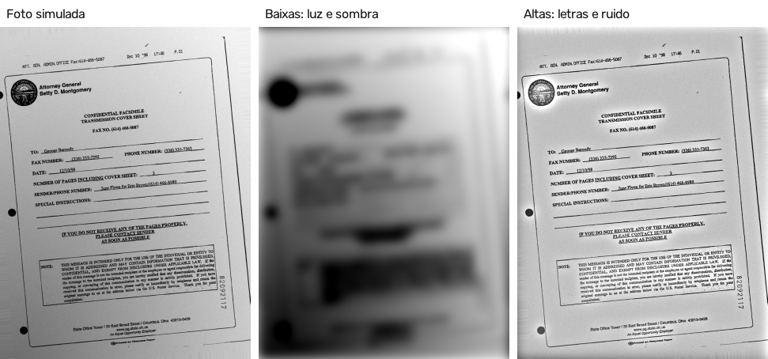
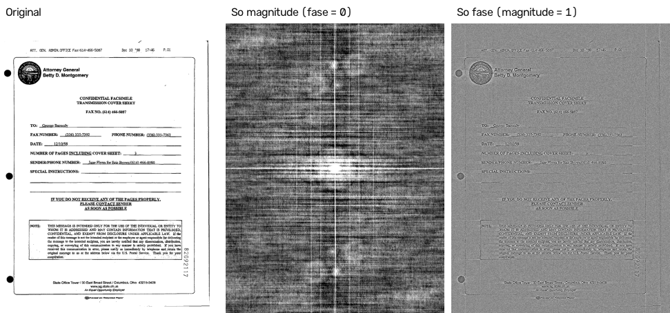
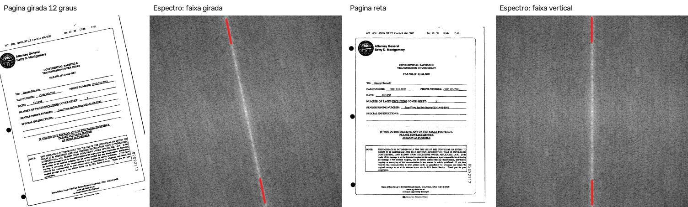
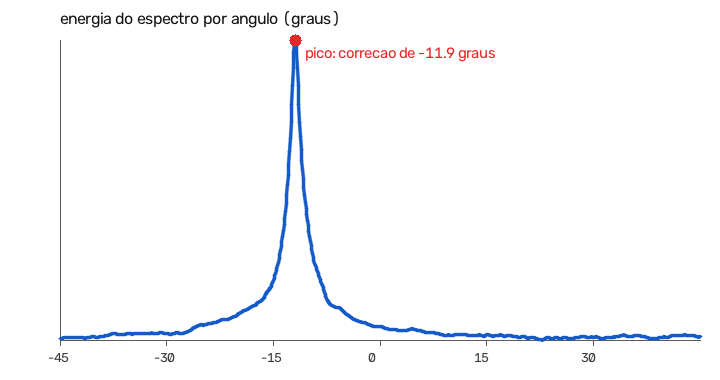
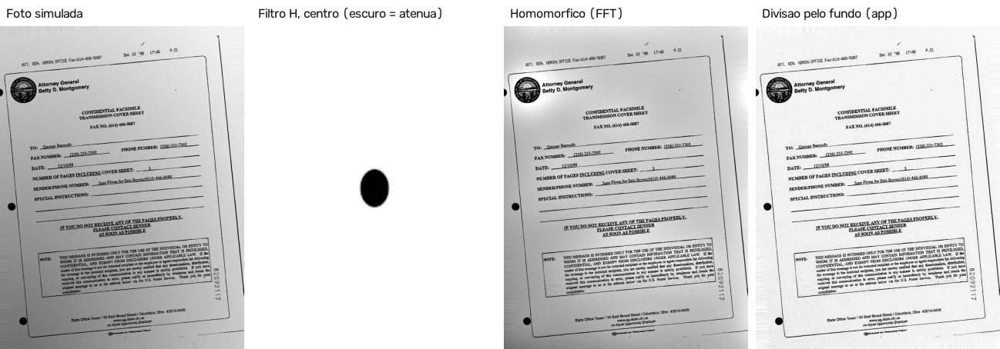

# Transformada de Fourier (FFT) no NeXo Estudos

A transformada de Fourier tem dois papéis no projeto:

1. **No pipeline do app:** medir a inclinação do texto no espectro de magnitude e endireitar a página (etapa 9 de [PIPELINE.md](PIPELINE.md)). Essa medida substituiu o método anterior, o perfil de projeção.
2. **Avaliada e não adotada:** o filtro homomórfico, que corrige a iluminação no domínio da frequência. Ele foi comparado com a normalização de iluminação usada no app e perdeu; a comparação está na seção 4.

O código está em `backend/frequencia.py`. As escolhas foram feitas no conjunto de **treino** do FUNSD (`tools/ajustar_fft.py`) e os resultados abaixo são do conjunto de **teste**, com 50 imagens (`tools/avaliar_fft.py`).

## 1. O que é transformado

A FFT 2D decompõe uma imagem numa soma de ondas (senoides em duas dimensões). Cada ponto do **espectro** representa uma dessas ondas:

- **distância ao centro** = frequência: quantas repetições a onda tem por pixel;
- **direção** a partir do centro = orientação da onda;
- **magnitude** = quanto daquela onda existe na imagem;
- **fase** = onde a onda está posicionada.

Na medida de inclinação, a entrada é a **imagem binária** da página (tinta = 1, papel = 0), saída da segmentação tinta × papel, reduzida para no máximo 1024 pixels. No filtro homomórfico, a entrada é o **logaritmo da imagem em tons de cinza**.

### O que as frequências significam numa página

| Faixa | Onde fica no espectro | O que representa na página |
|---|---|---|
| Baixas | Perto do centro | Variações lentas de brilho: papel, sombra, iluminação desigual |
| Médias | Anel intermediário | A repetição das linhas de texto (entrelinha de 20 a 40 pixels) |
| Altas | Longe do centro | Bordas finas das letras, ruído do sensor, sujeira |



*Filtro gaussiano com corte em 0,01 ciclo por pixel. As baixas frequências guardam a luz e a sombra (a página vira um borrão); as altas guardam as letras e o ruído, sem a sombra.*

### Magnitude e fase



Reconstruindo a página só com a magnitude (fase zerada), nada da página é reconhecível. Só com a fase (magnitude 1 em todas as frequências), a estrutura aparece: as bordas do texto, das linhas e das caixas. A **fase diz onde as coisas estão**, e a **magnitude diz quais repetições e orientações existem**.

Isso justifica usar só a magnitude para medir a inclinação: o ângulo das linhas não depende de onde o texto está na página, e a magnitude não muda quando a página é deslocada (propriedade verificada pelo script de avaliação).

## 2. Uso no app: medida da inclinação

### Por que funciona

Linhas de texto paralelas, separadas por uma distância *d*, formam um padrão que se repete na direção **perpendicular** a elas. No espectro de magnitude, esse padrão vira uma fileira de picos que passa pelo centro, perpendicular às linhas, nas frequências múltiplas de 1/*d*. Girar a página gira o espectro pelo mesmo ângulo. Com o texto reto, a faixa é vertical; com a página torta, ela fica inclinada no ângulo do texto.



*As marcas vermelhas mostram a direção escolhida pelo método. Na página reta, a faixa é vertical.*

### Como é calculada (`medir_inclinacao_fft`)

1. A imagem binária é reduzida para no máximo 1024 pixels e multiplicada por uma **janela de Hann**. Sem a janela, as bordas da imagem criam uma "cruz" falsa no espectro.
2. A imagem é posta num quadrado preenchido com zeros, para que um ângulo no espectro seja o mesmo ângulo na página. Calcula-se a FFT 2D, centralizada com `fftshift`, e fica-se só com a magnitude.
3. Para cada ângulo entre −45° e 45°, de 0,1 em 0,1 grau, a magnitude é somada ao longo da reta que sai do centro naquela direção. Ficam de fora as frequências mais baixas (abaixo de 1% do lado: iluminação) e as mais altas (acima de 25%: ruído). A reta com mais energia dá a inclinação.
4. **Confiança:** se o pico não se destaca das outras direções (menos de 4 intervalos interquartis acima da mediana), a imagem não tem linhas de texto e não é girada.



*Página girada 12°: um pico estreito em −11,9° (a correção) e uma curva quase plana no resto.*

### Duas escolhas feitas no treino

**Soma linear, e não do logaritmo.** A primeira versão somava o logaritmo da magnitude, que é a escala usada para *visualizar* espectros. Ela funcionava nos formulários do FUNSD, mas errava feio em páginas muito regulares. No logaritmo, o "piso" do espectro pesa tanto quanto os picos; na escala linear, pesam os picos, que são as linhas de texto. Erro do ângulo em páginas giradas até ±40° (`tools/ajustar_fft.py`):

| Páginas de treino | Soma do log: erro médio | Soma do log: erro máximo | Soma linear: erro médio | Soma linear: erro máximo |
|---|---|---|---|---|
| FUNSD, 75 formulários | 0,48° | 2,16° | 0,48° | 2,16° |
| Texto renderizado, 4 a 40 linhas (40) | 1,84° | 72,23° | 0,03° | 0,16° |
| Blocos de palavras, muito regulares (40) | 16,26° | 84,90° | 0,03° | 0,08° |

No FUNSD as duas empatam (o erro de cerca de 0,5° é a inclinação que os próprios scans já têm). Nas páginas sintéticas, o logaritmo chega a errar por mais de 70°; a soma linear não passa de 0,16°.

**Limiar de confiança.** O destaque do pico foi medido em 596 páginas de treino com texto (cada uma como scan, foto simulada, foto em perspectiva recortada e girada até ±40°) e em 83 imagens sem texto (manchas aleatórias em várias escalas e uma foto). Com texto, o menor destaque foi 7,1 (mediana de 22,9); sem texto, o maior foi 3,6 (mediana de 2,0). Os dois erros possíveis têm custos diferentes: rejeitar uma página com texto deixa de endireitá-la e piora o OCR; aceitar uma imagem sem texto só a gira, e não há texto a perder. Por isso o limiar é o **menor valor que não aceitou nenhuma imagem sem texto** no treino: **4,0**.

A primeira versão usava 5,0, o meio da faixa. Ela rejeitou uma página esparsa do conjunto de teste (formulário em duas colunas, destaque de 4,6), que ficou sem correção. A regra foi trocada pela de custo descrita acima, e o novo valor saiu dos dados de treino. Como a troca foi motivada por um caso do teste, ela fica registrada aqui.

### Resultados (conjunto de teste)

O ângulo certo é conhecido porque o script aplica a rotação. O erro inclui a inclinação que o próprio scan do FUNSD já tem (até cerca de 2°), igual para todos os métodos.

| Cenário | Método | Erro médio | Erro mediano | Erro máximo | Até 1° | Tempo por página |
|---|---|---|---|---|---|---|
| Foto simulada (giro de 3° a 6°) | Projeção ±15° (antes) | 0,30° | 0,17° | 2,09° | 98% | 40 ms |
| Foto simulada (giro de 3° a 6°) | Projeção ±45° | 0,30° | 0,17° | 2,09° | 98% | 86 ms |
| Foto simulada (giro de 3° a 6°) | **FFT ±45° (app)** | **0,32°** | **0,19°** | **2,09°** | **98%** | **62 ms** |
| Giro grande (até ±40°) | Projeção ±15° (antes) | 12,07° | 6,02° | 54,05° | 34% | 41 ms |
| Giro grande (até ±40°) | Projeção ±45° | 0,30° | 0,18° | 2,04° | 98% | 85 ms |
| Giro grande (até ±40°) | **FFT ±45° (app)** | **0,31°** | **0,18°** | **2,04°** | **98%** | **61 ms** |

- Com giros pequenos, as duas medidas empatam (diferença de 0,02°).
- Com giros grandes, a projeção na faixa antiga (±15°) não alcança o ângulo certo. Para cobrir ±45°, ela passa a gastar 85 ms por página; a FFT cobre a mesma faixa em 61 ms, com a mesma precisão.

**Efeito no OCR de páginas muito tortas.** As 50 páginas de teste foram giradas entre 15° e 40° (para um lado ou para o outro), numa tela maior, para nenhum texto sair da imagem:

| Pipeline | F1 do OCR |
|---|---|
| Com a projeção ±15° (antes) | 23,9% |
| **Com a FFT ±45° (agora)** | **69,3%** |

Esse é o ganho da troca no resultado final do app: páginas fotografadas bem tortas passam a ser lidas quase tão bem quanto um scan reto (71,9%).

**Efeito no OCR das condições usuais** (giro de no máximo 6°): F1 de 71,9% nos scans, 67,8% nas fotos simuladas e 63,6% nas fotos em perspectiva, contra 72,1%, 67,6% e 63,3% com a projeção. As diferenças, de até 0,3 ponto, vêm de ângulos que mudaram 0,1° em algumas páginas.

**Confiança no teste.** As 50 páginas de teste foram aceitas (menor destaque: 4,7). Das 31 imagens sem texto (30 sintéticas e uma foto), 1 passou do limiar (destaque 4,5) e seria girada à toa. É o erro barato que o limiar aceita de propósito: girar uma imagem sem texto não piora nenhuma leitura.

## 3. Por que a FFT, e não só a projeção

As duas medem o ângulo com a mesma precisão. A diferença está no custo de testar ângulos: a projeção precisa **girar a imagem inteira** para cada ângulo testado; na FFT, o espectro é calculado **uma vez**, e testar um ângulo a mais custa apenas somar uma reta. Por isso a faixa pôde passar de ±15° para ±45° gastando menos tempo do que a projeção gastaria na mesma faixa. O espectro também diz **se há texto**: sem linhas de texto não há faixa, e a página não é girada à toa.

## 4. Avaliado e não adotado: filtro homomórfico

### Como funciona (`filtro_homomorfico`)

Uma foto é aproximadamente **iluminação × refletância**: a luz varia devagar (baixa frequência) e as letras variam rápido (alta frequência). No logaritmo, o produto vira soma, e a FFT pode separar as duas parcelas:

1. logaritmo da imagem;
2. FFT 2D;
3. multiplicação por um filtro gaussiano *H*, que dá ganho γL < 1 às baixas frequências (atenua a iluminação) e γH às altas;
4. FFT inversa e exponencial.

É o equivalente, no domínio da frequência, da **divisão pelo fundo** que o app usa (etapa 6 do pipeline).



### Ajuste no treino

Grade de parâmetros em 20 imagens de treino, F1 do OCR (`tools/ajustar_fft.py`). O corte está em ciclos por pixel.

| Variante | Scan | Foto simulada |
|---|---|---|
| **Divisão pelo fundo (app)** | 76,9% | **74,5%** |
| Homomórfico, corte 0,002, γL 0,4, γH 1,0 | 77,1% | 68,7% |
| **Homomórfico, corte 0,003, γL 0,4, γH 1,0 (melhor)** | **77,8%** | 70,2% |
| Homomórfico, corte 0,005, γL 0,4, γH 1,0 | 77,2% | 69,8% |
| Homomórfico, corte 0,003, γL 0,2, γH 1,0 | 73,7% | 66,0% |
| Homomórfico, corte 0,003, γL 0,4, γH 1,5 | 70,1% | 58,7% |
| Homomórfico, corte 0,005, γL 0,4, γH 1,5 | 59,6% | 59,7% |

Realçar as altas frequências (γH = 1,5, o "passa-alta de ênfase" clássico) realça também o ruído do papel e piora o OCR. A melhor configuração só atenua as baixas frequências. No treino, ela ganhou da divisão pelo fundo nos scans (+0,9 ponto), mas perdeu 4,3 pontos nas fotos, que são o uso principal do app (estudante fotografando o material).

### Resultado no teste

| Método | F1 do OCR, scan | F1 do OCR, foto simulada | F1 por pixel da tinta, foto simulada |
|---|---|---|---|
| **Divisão pelo fundo (app)** | **71,9%** | **67,8%** | **86,6%** |
| Filtro homomórfico (FFT) | 70,9% | 66,1% | 80,7% |

(A última coluna vem da avaliação com gabarito por pixel em [SEGMENTACAO.md](SEGMENTACAO.md).)

### Por que perdeu

- **O filtro é linear e enxerga a tinta como "iluminação".** Regiões com muito texto são, em média, mais escuras; para um filtro passa-baixa, isso parece sombra. A divisão pelo fundo começa com uma **dilatação**, que apaga as letras antes de estimar o fundo, de modo que a tinta fica fora da estimativa. É uma operação não linear, que um filtro de frequência não reproduz.
- **Sombras com borda nítida têm altas frequências.** Para remover a borda de uma sombra, o filtro teria de atenuar frequências que também formam as letras. Na figura, sobra sombra no canto inferior esquerdo.
- **A FFT supõe que a imagem se repete nas bordas.** O lado esquerdo "encosta" no direito; com sombra num canto, isso cria halos nas margens.

A FFT continua no projeto onde ela é melhor que a alternativa espacial: na medida de inclinação.

## Limitações

- A faixa é de ±45°. Uma foto de lado (90°) ou de cabeça para baixo (180°) não é corrigida: a magnitude de uma página e a da mesma página girada 180° são idênticas. Resolver isso exige detectar a orientação das letras, por exemplo com o modo OSD do Tesseract.
- Páginas com pouco texto ou diagramação irregular têm um pico mais fraco: a menor confiança entre as páginas de teste ficou em 4,7, perto do limiar de 4.
- As rotações e as imagens sem texto da avaliação são sintéticas. Em fotos reais, a página pode estar curvada, e as linhas deixam de ser retas.
- Os tempos foram medidos num único computador e servem para comparar os métodos entre si, não como valor absoluto.

## Como reproduzir

Na raiz do projeto, com o ambiente virtual ativo e o Tesseract instalado:

```powershell
python tools/ajustar_fft.py              # escolhas feitas no treino
python tools/avaliar_fft.py              # resultados no teste e figuras
python tools/avaliar_fft.py --sem-ocr    # sem as comparações pelo OCR (mais rápido)
python tools/avaliar_fft.py --so-figuras # só refaz as figuras
```

`avaliar_fft.py` grava `docs/fft/resultados.json` e as figuras de `docs/fft/`.
