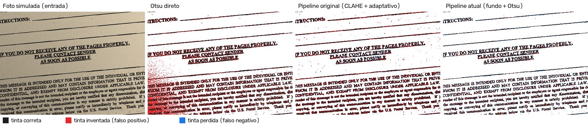
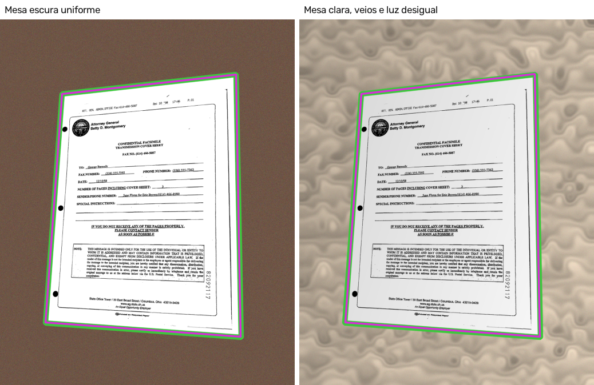

# Segmentação no NeXo Estudos

O pipeline faz duas segmentações, e cada uma foi avaliada **diretamente**, com gabarito, e não só pelo resultado final do OCR:

1. **Segmentação da folha (região de interesse):** separa a folha da mesa numa foto tirada de lado (`detectar_folha`, em `backend/perspectiva.py`).
2. **Segmentação tinta × papel:** separa o texto do fundo, produzindo a imagem binária que vai para o OCR (`segmentar_texto`, em `backend/processamento.py`).

As duas são medidas nas **50 imagens de teste** do FUNSD, com o script `tools/avaliar_segmentacao.py`. Os parâmetros foram escolhidos antes, no conjunto de treino ([AVALIACAO.md](AVALIACAO.md)).

## 1. Segmentação tinta × papel

### Como funciona

1. **Normalização de iluminação:** uma dilatação 7 × 7 apaga as letras (mais escuras que o papel) e um filtro mediano 31 × 31 estima o fundo; a imagem é dividida por esse fundo, que fica uniforme.
2. **Filtro mediano 3 × 3:** remove pontos isolados de ruído sem borrar as bordas das letras.
3. **Limiar de Otsu:** escolhe automaticamente o nível de cinza que melhor separa os dois grupos de pixels (tinta e papel). Um limiar global funciona porque o passo 1 já igualou a iluminação.

### Como foi avaliada

- **Gabarito por pixel:** o FUNSD anota palavras, não pixels. A referência é a tinta do **scan limpo** (Otsu aplicado ao scan original). A imagem é então degradada como uma foto de celular (sombra, papel amarelado, ruído e rotação de 3° a 6°) e o gabarito é girado pela mesma matriz. Cada método segmenta a foto e é comparado ao gabarito só na área que contém imagem.
- **Métricas por pixel:** precisão (da tinta encontrada, quanto é tinta de verdade), revocação (da tinta verdadeira, quanto foi encontrado), F1 (igual ao coeficiente de Dice) e IoU (interseção sobre união).
- **Métrica por palavra:** usando as caixas anotadas do FUNSD, uma palavra conta como **bem segmentada** quando o F1 da tinta dentro da sua caixa é de pelo menos 0,8.

### Resultados (conjunto de teste, média por imagem)

**Foto simulada:**

| Método | Precisão | Revocação | F1 (Dice) | IoU | Palavras bem segmentadas |
|---|---|---|---|---|---|
| Otsu direto, sem pré-processamento | 30,0% | 98,1% | 41,3% | 29,2% | 59,1% |
| Pipeline original (CLAHE + limiar adaptativo) | 58,4% | 94,1% | 71,9% | 56,3% | 28,4% |
| Filtro homomórfico (FFT) + mediana + Otsu | 81,2% | 84,7% | 80,7% | 69,7% | 84,9% |
| **Pipeline atual (fundo + mediana + Otsu)** | **85,6%** | **87,7%** | **86,6%** | **76,4%** | **89,9%** |

**Scan original:**

| Método | Precisão | Revocação | F1 (Dice) | IoU | Palavras bem segmentadas |
|---|---|---|---|---|---|
| Pipeline original (CLAHE + limiar adaptativo) | 74,1% | 92,2% | 82,1% | 69,8% | 53,1% |
| Filtro homomórfico (FFT) + mediana + Otsu | 94,2% | 86,6% | 88,4% | 81,3% | 92,3% |
| **Pipeline atual** | **96,3%** | **91,3%** | **93,7%** | **88,2%** | **99,4%** |

(No scan, o Otsu direto não entra na tabela: ele é o próprio gabarito.)



*Preto: tinta correta. Vermelho: tinta inventada (falso positivo). Azul: tinta perdida (falso negativo).*

### O que os números mostram

- **Otsu direto** encontra quase toda a tinta (revocação de 98%), mas 70% do que ele marca como tinta é sombra: com a luz desigual, um único limiar não separa tinta e papel. Na figura, a sombra do canto vira uma mancha vermelha.
- **Pipeline original:** o limiar adaptativo acompanha a luz, mas o CLAHE realça a granulação do papel. Sobra pontilhado no fundo e os traços engrossam: só 28% das palavras ficam bem segmentadas.
- **Pipeline atual:** 86,6% de F1 por pixel e **9 em cada 10 palavras bem segmentadas** na foto; no scan, 99,4% das palavras.
- **Filtro homomórfico (FFT):** é a versão "em frequência" da normalização de iluminação. Melhora muito sobre os métodos antigos, mas fica abaixo da divisão pelo fundo. O motivo está em [FFT.md](FFT.md): o filtro é linear e mistura a tinta na estimativa da iluminação, enquanto a dilatação + mediana a exclui.
- **Sensibilidade ao tamanho da janela do fundo:** com janelas de 15, 31 e 61 pixels, o F1 na foto ficou entre 86,6% e 86,7%, e as palavras bem segmentadas entre 89,7% e 90,0%. O parâmetro não é crítico nessa faixa.

## 2. Segmentação da folha (recorte da região de interesse)

### Como funciona

Numa cópia reduzida da foto, as bordas são detectadas (Canny) e fechadas por morfologia. Entre os maiores contornos, o primeiro que forma um quadrilátero convexo ocupando de 20% a 97% da foto, e que seja bem mais claro por dentro do que numa faixa logo fora (contraste mínimo de 25 níveis de cinza), é a folha. Os detalhes estão na etapa 4 de [PIPELINE.md](PIPELINE.md).

### Como foi avaliada

- **Gabarito:** as fotos em perspectiva são geradas pelo script a partir dos scans, então a posição real da folha (a homografia aplicada) é conhecida.
- **Dois cenários:** mesa escura uniforme (o mesmo da [avaliação do OCR](AVALIACAO.md)) e um cenário difícil, com **mesa clara com veios de madeira e luz caindo de um lado** (até 30% mais escuro). A mesa clara reduz o contraste entre folha e fundo, e os veios criam bordas falsas.
- **Métricas:** folhas detectadas; IoU entre o quadrilátero detectado e o real (0 quando não detecta); erro médio dos cantos, em porcentagem da diagonal da folha; e **falsos alarmes** em 100 imagens sem mesa (50 scans e 50 fotos simuladas sem perspectiva), onde não há nada a recortar.

### Resultados (conjunto de teste, 50 fotos por cenário)

| Contraste mínimo | Cenário | Detectadas | IoU médio | IoU ≥ 0,95 | Erro dos cantos | Falsos alarmes |
|---|---|---|---|---|---|---|
| 10 | Mesa escura | 50/50 | 0,995 | 100% | 0,14% | 0/100 |
| 10 | Mesa clara, veios e luz desigual | 49/50 | 0,974 | 98% | 0,17% | |
| **25 (usado no app)** | **Mesa escura** | **50/50** | **0,995** | **100%** | **0,14%** | **0/100** |
| **25 (usado no app)** | **Mesa clara, veios e luz desigual** | **49/50** | **0,974** | **98%** | **0,17%** | |
| 40 | Mesa escura | 50/50 | 0,995 | 100% | 0,14% | 0/100 |
| 40 | Mesa clara, veios e luz desigual | 43/50 | 0,855 | 86% | 0,16% | |



### O que os números mostram

- Quando a folha é encontrada, ela é recortada com precisão: os cantos ficam, em média, a 0,14%–0,17% da diagonal do lugar certo (cerca de 2 pixels; a folha tem, em média, 1.260 pixels de diagonal na foto).
- **Nenhum falso alarme** nas 100 imagens sem mesa, com qualquer limiar.
- O **limiar de contraste** só faz diferença no cenário difícil: 40 perde 6 folhas a mais; 10 não ganha nenhuma em relação a 25. O valor usado (25) fica do lado seguro. Mesmo sem efeito nos falsos alarmes desta avaliação, o teste de contraste é o que impede recortar a moldura impressa de um scan comum (caso coberto pelos testes automáticos em `tests/test_perspectiva.py`).
- A única folha perdida (imagem 85201976, mesa clara): um veio claro da mesa encosta no canto da folha e as bordas do Canny se fundem, de modo que o contorno deixa de ser um quadrilátero. Nesse caso o app segue com a foto inteira, sem recorte.

## Limitações

- O gabarito de tinta vem do scan limpo, não de uma anotação manual por pixel. A avaliação mede quanto da segmentação do scan o pipeline recupera a partir da foto; erros que já existem no scan não são medidos.
- Fotos e mesas são simuladas. Fotos reais podem trazer dobras, reflexos, a mão segurando a folha ou cantos fora do quadro (quando um canto não aparece, a folha não é detectada).
- O FUNSD é formado por formulários em inglês; materiais em português, com outra diagramação, podem se comportar de outro jeito.

## Como reproduzir

Na raiz do projeto, com o ambiente virtual ativo:

```powershell
python tools/avaliar_segmentacao.py
```

O script baixa o FUNSD se necessário, roda as duas avaliações (alguns minutos, sem precisar do Tesseract) e grava `docs/segmentacao/resultados.json` e as figuras.
